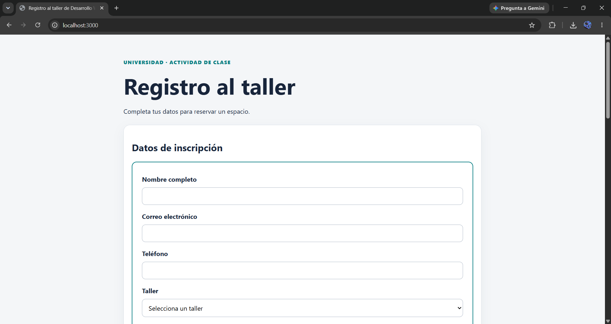
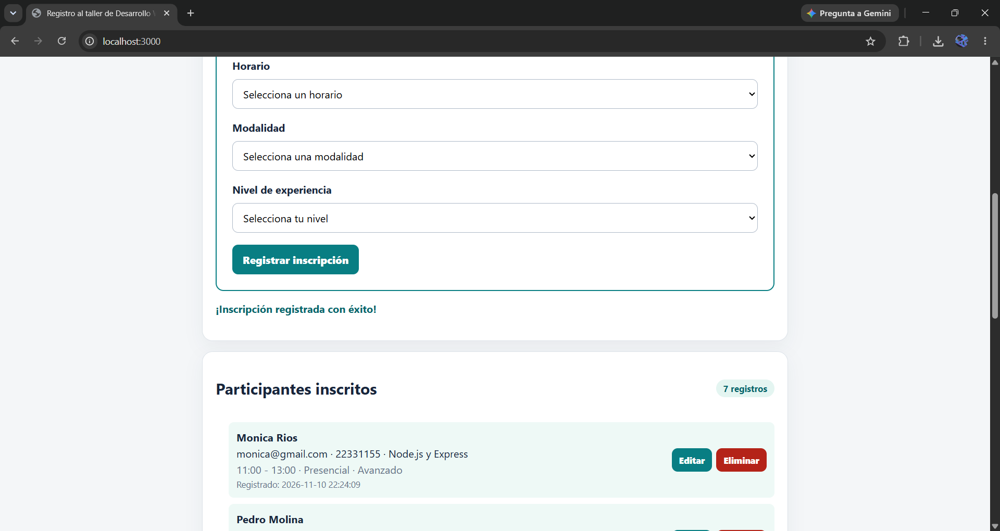
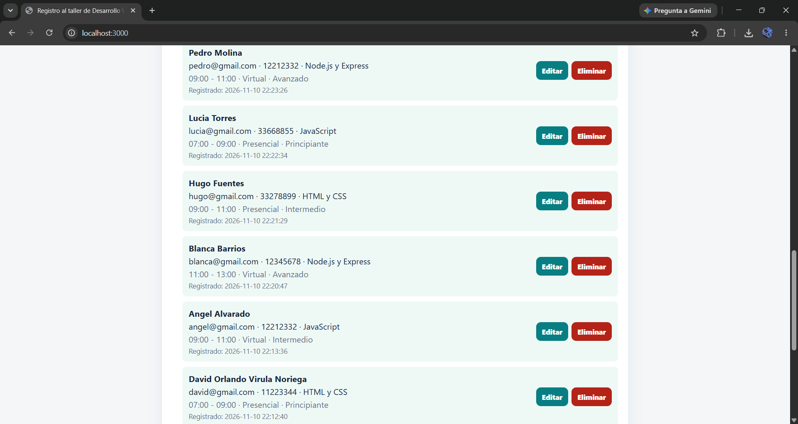
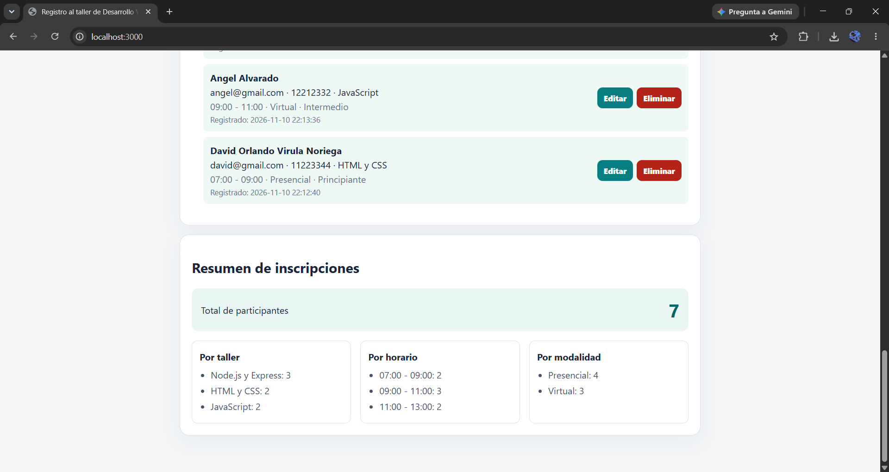
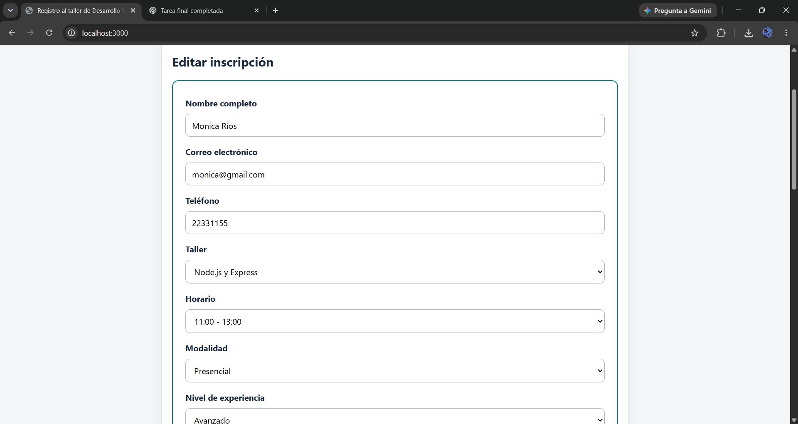

# Registro de participantes para un taller

Aplicación web para registrar participantes, consultar inscripciones, editarlas, eliminarlas y revisar reportes agrupados por taller, horario y modalidad. Se conserva la interfaz base del proyecto y se amplía para cumplir con los requisitos de la tarea.

## Requisitos

- Node.js 22.13.0 o superior (se utiliza el módulo integrado `node:sqlite`).
- npm.
- Visual Studio Code (recomendado).

## Instalación y ejecución

1. Abre la carpeta `registro-taller-estudiante` en Visual Studio Code.
2. Abre una terminal en esa carpeta.
3. Instala Express:

   ```bash
   npm install
   ```

4. Inicia el servidor:

   ```bash
   npm start
   ```

5. Abre `http://localhost:3000` en el navegador.

Si PowerShell bloquea `npm.ps1`, utiliza `npm.cmd install` y `npm.cmd start`.

La base de datos `inscripciones.sqlite` se crea automáticamente al iniciar el servidor. No es necesario crearla manualmente. El archivo se genera localmente y está excluido de Git mediante `.gitignore`.

## Campos del registro

Nombre, correo, teléfono, taller, horario, modalidad y nivel de experiencia. Todos son obligatorios; el correo se valida tanto en el navegador como en el servidor.

## API

| Método | Ruta | Función |
|---|---|---|
| GET | `/api/inscripciones` | Lista todas las inscripciones |
| POST | `/api/inscripciones` | Crea una inscripción |
| PUT | `/api/inscripciones/:id` | Actualiza una inscripción |
| DELETE | `/api/inscripciones/:id` | Elimina una inscripción |
| GET | `/api/reportes/resumen` | Devuelve total y agrupaciones por taller, horario y modalidad |

Las rutas de creación y actualización reciben JSON con `nombre`, `correo`, `telefono`, `taller`, `horario`, `modalidad` y `nivel_experiencia`. Los errores de validación devuelven HTTP 400; los identificadores inexistentes devuelven HTTP 404.

## Estructura

- `server.js`: servidor Express y API REST.
- `database.js`: conexión y creación de la tabla SQLite.
- `public/index.html`: formulario y vistas.
- `public/styles.css`: estilos y diseño adaptable.
- `public/app.js`: consumo de la API y comportamiento de la interfaz.
- `bitacora.md`: registro de cambios y pruebas.

## Pruebas recomendadas

1. Registrar una inscripción con todos los campos completos.
2. Intentar registrar con un campo vacío o un correo inválido.
3. Actualizar un registro desde el botón **Editar**.
4. Eliminar un registro y comprobar que desaparezca.
5. Consultar los reportes y verificar que cambien al registrar o eliminar.
6. Detener y volver a iniciar el servidor; comprobar que los registros continúan guardados.
7. Probar la vista en una pantalla estrecha de teléfono.

## GitHub

Inicializa o utiliza el repositorio Git de la clase. Realiza commits descriptivos para los cambios, por ejemplo:

- `Completa formulario y validaciones`
- `Implementa persistencia SQLite y API CRUD`
- `Agrega edición, eliminación y reportes`

No subas `node_modules`, archivos `.env` ni la base de datos local.

## Evidencias del sistema

### 1. Página principal


### 2. Formulario de inscripción


### 3. Inscripciones registradas


### 4. Reportes


### 5. Edición de inscripción

